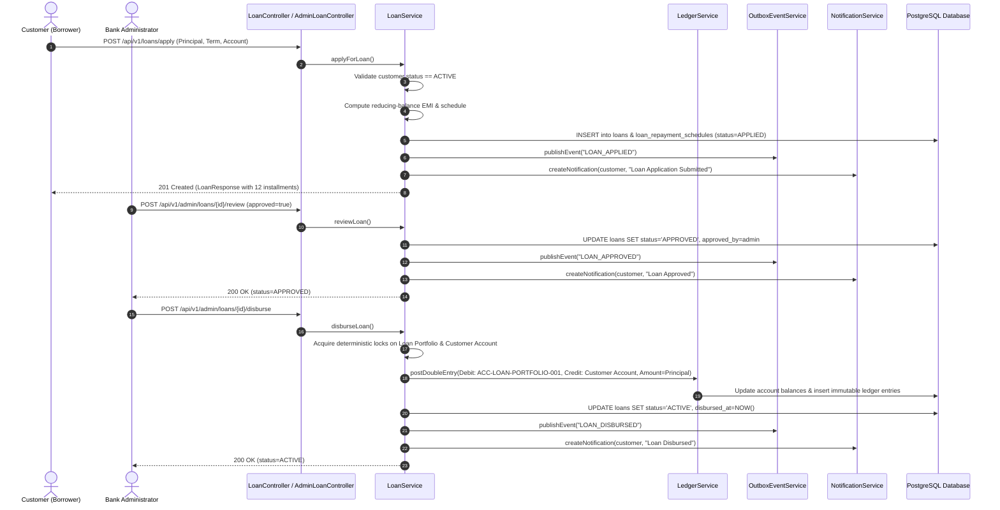
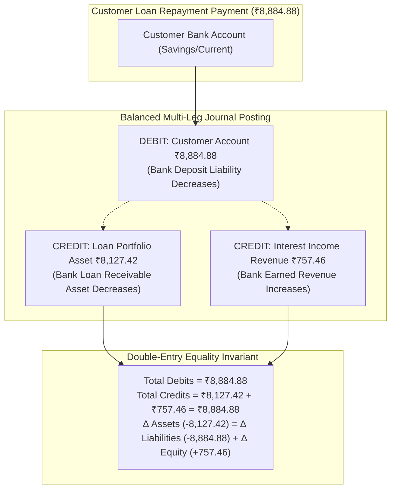
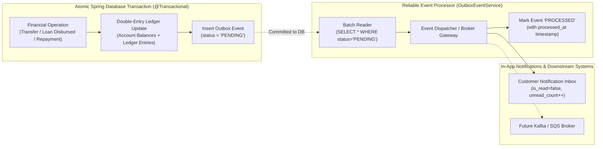
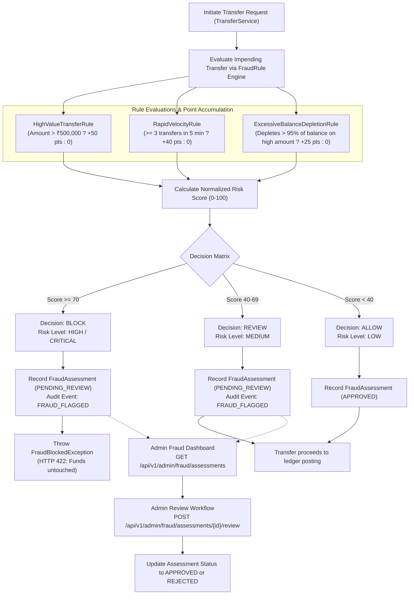
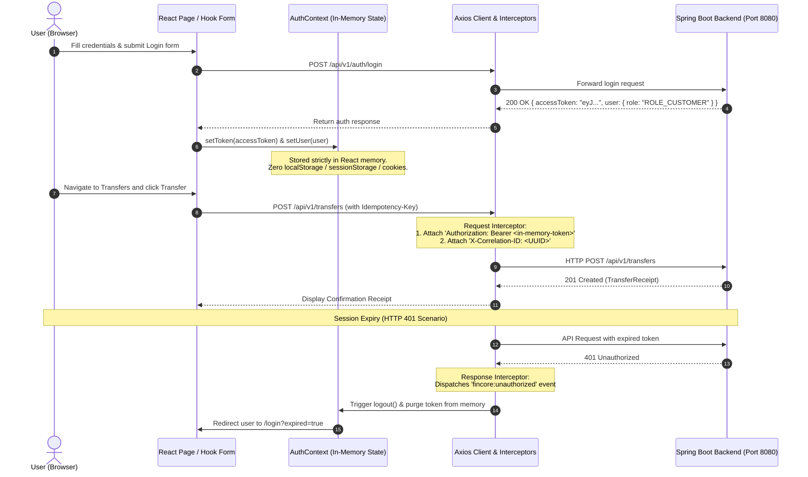

# FinCore Banking Platform — Enterprise Full-Stack Banking Simulation
**Backend Engine + Enterprise React/TypeScript Web Portal**

FinCore Banking Platform is an enterprise-style banking simulation engineered as a portfolio project. It demonstrates a complete, production-grade digital banking web application and core banking engine: modern React/TypeScript frontend portal, modular Spring Boot 3 backend architecture, resilient security patterns, in-memory cryptographic session management, role-based access control (RBAC), multi-category double-entry ledger accounting, deterministic concurrency controls, idempotent transfers, loan lifecycle management, transactional outbox event messaging, real-time rule-based fraud detection, database migrations, and local-first reliability.

> **Portfolio Engineering Disclaimer:** FinCore Banking Platform is a technical architecture portfolio project and banking simulation. It is not a real financial institution, has no banking license, does not handle real customer funds, and does not use real banking credentials or live customer data.

---

## Technical Stack & Architecture

### Backend Core Engine (`/backend`)
- **Language & Runtime:** Java 21 (LTS)
- **Framework:** Spring Boot 3.3.6 (Spring Security 6, Spring Data JPA, Bean Validation, Spring Boot Actuator)
- **Database:** PostgreSQL 16 / H2 for fast unit testing (with Flyway database migrations `V1` through `V6`)
- **Token Security:** JJWT 0.12.6 (Signed HMAC-SHA256 JWT access tokens & cryptographically hashed refresh tokens)
- **Accounting Engine:** Multi-category double-entry append-only immutable ledger ($\sum Debits = \sum Credits$)
- **Concurrency Control:** Deterministic UUID lock ordering with PostgreSQL row-level pessimistic write locking
- **Idempotency:** SHA-256 request payload fingerprinting with 24-hour result caching
- **Event Dispatching:** Transactional Outbox pattern avoiding dual-write hazards
- **Risk & Fraud Engine:** Configurable rule-based evaluation pipeline with automated tri-state decisioning (`ALLOW`, `REVIEW`, `BLOCK`)
- **API Documentation:** Springdoc OpenAPI 2.6.0 (Swagger UI 3 / OpenAPI 3.0 specification)
- **Testing:** JUnit 5, Mockito, Spring Boot Test Slice, Testcontainers (84 passing tests)

### Enterprise Web Frontend (`/frontend`)
- **Language & Runtime:** TypeScript 5.8 / Node.js 22 (LTS)
- **Build & Development Tooling:** Vite 6 / ES2022 Bundler
- **Core Library:** React 19 (Hooks, Suspense, Concurrent rendering)
- **Styling & UI Design:** Tailwind CSS 3.4 (Custom enterprise palette: `#0B192C` Deep Navy, `#2563EB` Royal Blue, `#F59E0B` Amber Gold, Accessible Slate neutrals)
- **State & Server Cache:** TanStack React Query 5 (Automatic query invalidation, background caching, mutation lifecycle)
- **Routing & Guards:** React Router 7 (Nested routes, `ProtectedRoute` RBAC enforcement for `CUSTOMER` and `ADMIN`)
- **Forms & Validation:** React Hook Form 7 + Zod 3 (Client-side schema validation matching backend DTO contracts)
- **Icons & Visuals:** Lucide React (Enterprise iconography)
- **Analytics & Charts:** Recharts 2.15 (Responsive SVG charts for asset allocation and balance trends)
- **HTTP Client:** Axios 1.7 (Custom request/response interceptors, in-memory token injection, correlation ID tracing)
- **Testing:** Vitest 3 + React Testing Library + `@testing-library/jest-dom` (20 passing integration tests)

---

## Banking Core Architecture (Phase 01–03 Capabilities)

### 1. Customer Domain & Identity Linking
- Each customer profile is linked 1-to-1 with an authenticated `User` account.
- Self-service endpoints (`GET /api/v1/customers/me`, `PUT /api/v1/customers/me`) allow customers to query and update contact/address information.
- Admin endpoints (`GET /api/v1/admin/customers`, `GET /api/v1/admin/customers/{customerId}`) provide authorized administrative oversight.
- Duplicate profile creation for the same authenticated user is strictly prevented (HTTP 409 Conflict).

### 2. Bank Account Management
- Supports `SAVINGS`, `CURRENT`, `LOAN_PORTFOLIO`, `CENTRAL_SETTLEMENT`, `INTEREST_INCOME`, and `SYSTEM_RESERVE` account types across 5 formal accounting categories:
  - **ASSETS:** `LOAN_PORTFOLIO`, `CENTRAL_SETTLEMENT` (Normal balance: Debit)
  - **LIABILITIES:** `SAVINGS`, `CURRENT` (Normal balance: Credit)
  - **EQUITY:** `SYSTEM_RESERVE` (Normal balance: Credit)
  - **REVENUE:** `INTEREST_INCOME` (Normal balance: Credit)
  - **EXPENSE:** Operational expense accounts (Normal balance: Debit)
- Accounts are identified by unique numbers (`ACC-XXXXXXXXXXXX`).
- Balance representation uses `BigDecimal` with explicit scale 2 (`HALF_EVEN` rounding) and non-negative constraints (`CHECK balance >= 0.00`).
- Account lifecycle states: `ACTIVE`, `FROZEN`, `CLOSED`.
- Administrative endpoints allow freezing/unfreezing accounts with mandatory audit reasons. Frozen/closed accounts cannot initiate or receive transfers.

### 3. Double-Entry Accounting Model & Banking Correctness
- Every monetary transaction produces balanced, immutable ledger entries:
  - **Customer Outflow (Transfer Sender):** Debit Customer Deposit (decreases bank liability).
  - **Customer Inflow (Transfer Recipient):** Credit Customer Deposit (increases bank liability).
  - **Loan Disbursement:** Debit Loan Portfolio Asset (increases loan asset) = Credit Customer Deposit (increases bank liability).
  - **Loan Repayment:** Debit Customer Deposit (decreases deposit liability) = Credit Loan Portfolio Asset (decreases loan asset) + Credit Interest Income Revenue (increases revenue).
- **Mathematical Invariant:** $\sum Debits = \sum Credits$ for every posted transaction.
- **Single Reversal Invariant:** Database-level unique constraint (`uq_tx_reversal_of_transaction`) guarantees that a transaction can never be reversed twice under any concurrent race condition.
- Real-time reconciliation endpoint (`GET /api/v1/accounts/{accountNumber}/reconciliation`) verifies that the account balance equals $\sum Credits - \sum Debits$ for liabilities or $\sum Debits - \sum Credits$ for assets.

### 4. Loan Lifecycle & Reducing-Balance Amortization
- Public quotation calculator (`POST /api/v1/loans/calculate-emi`) calculates standard reducing-balance monthly installments:
  $$EMI = \frac{P \cdot r \cdot (1 + r)^n}{(1 + r)^n - 1}$$
- Full lifecycle states: `APPLIED` $\rightarrow$ `APPROVED` $\rightarrow$ `DISBURSED` $\rightarrow$ `ACTIVE` $\rightarrow$ `CLOSED` (or `REJECTED`).
- Automated generation of 1..N installment schedules upon application.
- Repayment allocation follows strict banking protocol: payments are applied first to overdue and accrued interest, with the remainder reducing principal.

### 5. Transactional Outbox Pattern & In-App Notifications
- Decouples core financial transactions from external notifications and message brokers without dual-write hazards.
- Events (`LOAN_APPLIED`, `LOAN_APPROVED`, `LOAN_DISBURSED`, `LOAN_REPAID`, `TRANSFER_COMPLETED`, etc.) are atomically inserted into `outbox_events` within the same database transaction.
- An autonomous batch processor dispatches events to the customer notification inbox (`notifications`) with unread counters, read state tracking, and ownership isolation.

### 6. Real-Time Rule-Based Fraud Detection Engine
- Evaluates impending transfers prior to ledger posting against three real-time behavioral rules:
  1. `HighValueTransferRule`: Transfers exceeding ₹500,000 (+50 risk score).
  2. `RapidVelocityRule`: Source accounts initiating 3 or more transfers within a 5-minute rolling window (+40 risk score).
  3. `ExcessiveBalanceDepletionRule`: Transfers that deplete >95% of available balance on amounts > ₹50,000 (+25 risk score).
- **Tri-State Decision Matrix:**
  - **Score < 40:** `ALLOW` (Transfer proceeds uninterrupted).
  - **Score 40–69:** `REVIEW` (Transfer proceeds, logged as `PENDING_REVIEW` for compliance).
  - **Score $\ge$ 70:** `BLOCK` (Transfer rejected with HTTP 422; accounts and balances remain untouched).
- Administrative compliance dashboard allows reviewing and approving/rejecting flagged transactions.

### 7. Concurrency & Deadlock Prevention
- When transferring between two accounts (A $\to$ B or B $\to$ A), database deadlocks occur if locks are acquired in arbitrary order.
- FinCore employs **deterministic lock ordering**:
  $$\text{First Lock} = \min(UUID_A, UUID_B), \quad \text{Second Lock} = \max(UUID_A, UUID_B)$$
- Row locks are acquired with pessimistic write locks (`SELECT ... FOR UPDATE`), serializing concurrent transfers deterministically.

### 8. Idempotent Transfer Execution
- All transfer operations require an `Idempotency-Key` HTTP header.
- A cryptographic SHA-256 fingerprint is calculated over `(sourceAccount|destinationAccount|amount|currency)`.
- Replaying the identical request returns the cached receipt immediately without double-debiting.
- Replaying the same key with altered transfer parameters is rejected with HTTP 422 Unprocessable Entity (`IdempotencyPayloadMismatchException`).

---

## Architecture & Operational Workflows (Mermaid Diagrams)

### Diagram 1: Loan Application to Disbursement Lifecycle


---

### Diagram 2: Loan Repayment Double-Entry Ledger Movement


---

### Diagram 3: Transactional Outbox Pattern & Notification Dispatch


---

### Diagram 4: Rule-Based Fraud Detection & Review Workflow


---

### Diagram 5: Frontend In-Memory Security & Interceptor Flow


---

## Step-by-Step Local Setup & Execution Guide

### 1. Database Setup (PostgreSQL)

Launch PostgreSQL via `psql` (or pgAdmin) and provision a dedicated database and user:

```sql
-- Connect to postgres server as superuser (postgres)
CREATE DATABASE fincore_db;

-- Create application user
CREATE USER fincore_user WITH ENCRYPTED PASSWORD 'fincore_password';

-- Grant required schema authorizations
GRANT ALL PRIVILEGES ON DATABASE fincore_db TO fincore_user;
ALTER DATABASE fincore_db OWNER TO fincore_user;
```

### 2. Environment Configuration

Copy the sample environment file to `.env`:

```powershell
Copy-Item .env.example .env
```

Ensure environment variables match your local database settings:
```properties
SERVER_PORT=8080
SPRING_PROFILES_ACTIVE=local
DB_HOST=localhost
DB_PORT=5432
DB_NAME=fincore_db
DB_USERNAME=fincore_user
DB_PASSWORD=fincore_password
```

### 3. Build & Test

Ensure your `JAVA_HOME` environment variable points to a JDK 21 installation:

```powershell
# Set JAVA_HOME (example in PowerShell)
$env:JAVA_HOME = "C:\Program Files\Android\Android Studio\jbr"

# Navigate to backend directory
cd backend

# Compile application source code
mvn clean compile

# Execute complete automated test suite (84 passing tests)
mvn test
```

### 4. Run the Application

Start the Spring Boot backend using Maven:

```powershell
mvn spring-boot:run -Dspring-boot.run.profiles=local
```

Or package and execute the standalone JAR:

```powershell
mvn clean package -DskipTests
java -jar target/fincore-banking-backend-1.0.0-SNAPSHOT.jar --spring.profiles.active=local
```

Once started, verify:
- **API Documentation (Swagger UI):** `http://localhost:8080/swagger-ui/index.html`
- **OpenAPI 3.0 JSON:** `http://localhost:8080/v3/api-docs`
- **Health Check:** `http://localhost:8080/actuator/health`

---

### 5. Frontend Web Application Setup & Execution (Prompt 04)

The enterprise frontend is located in `/frontend` and communicates with the Spring Boot backend on `http://localhost:8080`.

#### Prerequisites
- **Node.js:** v18.0.0+ (Tested and verified on Node.js v22.17.0)
- **Package Manager:** npm v10.0.0+

#### Installation & Configuration
```powershell
# Navigate to frontend directory
cd frontend

# Install dependencies
npm install

# Copy environment variables (configured for Vite proxy to http://localhost:8080)
Copy-Item .env.example .env
```

#### Running the Development Server
```powershell
# Start Vite development server
npm run dev
```
The application will be accessible at:
- **Customer & Admin Portal URL:** `http://localhost:5173`
- The Vite development server automatically proxies all `/api` and `/actuator` requests to `http://localhost:8080`.

#### Building for Production
```powershell
# Typecheck with TypeScript and build minified production bundle
npm run build
```
Build artifacts are compiled into `frontend/dist/`.

#### Running Frontend Automated Tests
```powershell
# Execute all 20 Vitest unit and integration tests
npm run test
```
All 20 test scenarios run headlessly using jsdom and React Testing Library.

---

## Enterprise Frontend Architecture & Portal Capabilities

FinCore Banking Platform features a production-grade, enterprise-ready banking user interface built with React 19, TypeScript, and Tailwind CSS. The interface strictly connects to real backend APIs with **zero hardcoded mock balances or transactions** on functional pages.

### 1. In-Memory Security & Authentication Model
- **Zero Local/Session Storage:** To eliminate Cross-Site Scripting (XSS) token extraction vectors, JWT access tokens are held **strictly in React in-memory state** (`AuthContext`). Refresh tokens are never exposed to browser scripts.
- **Session Lifecycles:** Closing or refreshing the browser tab securely clears the in-memory token, requiring re-authentication.
- **Transparent Correlation Tracking:** The Axios HTTP interceptor automatically stamps every outgoing client request with `X-Correlation-ID: crypto.randomUUID()` and injects `Authorization: Bearer <token>`.
- **Global 401 Session Interceptor:** If the backend returns HTTP 401 (token expired or revoked), the response interceptor triggers a global `fincore:unauthorized` custom event, wiping memory state and redirecting the user to `/login?expired=true`.
- **Role-Guarded Routing:** `ProtectedRoute` validates role claims (`ROLE_CUSTOMER` vs `ROLE_ADMIN`), redirecting unauthorized users to their respective home dashboard.

### 2. Customer Portal Modules
- **Customer Dashboard (`/dashboard`):** Real-time net portfolio balance calculation, active accounts cards, quick-transfer shortcut, and recent activity transaction ledger.
- **Account Management (`/accounts`, `/accounts/:id`):** 
  - Open new Savings and Current accounts in INR via modal dialog.
  - View individual account details, status badges (`ACTIVE`, `FROZEN`, `CLOSED`), and ledger transactions.
  - **Ledger Reconciliation Check:** One-click live audit reconciling customer balance against the double-entry journal ($\sum Credits - \sum Debits$).
- **Funds Transfers (`/transfers`):**
  - Interactive transfer flow with dynamic balance checking against the selected source account.
  - **Two-Step Confirmation Modal:** Mandatory confirmation dialog before posting sensitive financial actions.
  - **Idempotency Protection:** Generates a persistent UUID `Idempotency-Key` upon form initialization and preserves it across retries so network glitches cannot result in double debits.
  - **Real-Time Fraud Blocker Handling:** Catches HTTP 422 fraud engine rejections and displays instant alert banners with triggered risk details.
- **Loans & EMI Engine (`/loans`, `/loans/:id`):**
  - **Interactive EMI Quotation Calculator:** Public calculator modeling reducing-balance monthly installments and total interest payable.
  - **Loan Application:** Multi-step loan request wizard specifying loan type (`PERSONAL`, `HOME`, `AUTO`), principal amount, term in months, and disbursement deposit account.
  - **Amortization Schedule View:** Detailed breakdown of each installment (principal component, interest component, due date, status).
  - **Loan Repayments:** Execute full or partial installment repayments with instant double-entry ledger settlement receipt.
- **Notification Inbox (`/notifications`):** Live in-app alert feed with unread badge counter in top navigation bar, filter by category (`ALL`, `TRANSFER`, `LOAN`, `SECURITY`), and mark-as-read functionality.
- **Profile & Identity (`/profile`):** Customer profile management displaying verified KYC status (`VERIFIED`), synthetic National ID, and editable contact details.

### 3. Administrator & Compliance Dashboard Modules
- **Executive Admin Hub (`/admin`):** High-level overview of total deposits, total active loans, pending loan applications, and pending fraud reviews.
- **Customer Registry (`/admin/customers`):** Searchable table of all registered bank customers with associated accounts and contact metadata.
- **Account Supervision (`/admin/accounts`):** System-wide account ledger with one-click **Freeze / Unfreeze** controls requiring mandatory audit rationale.
- **Global Transaction Ledger & Reversals (`/admin/transfers`):** Real-time monitoring of all platform transactions with one-click **Reversal Workflow** enforcing single-reversal invariants.
- **Loan Underwriting & Disbursement (`/admin/loans`):** Underwriting queue allowing loan officers to inspect loan applications, approve/reject applications, and disburse approved loans with automatic double-entry ledger funding.
- **Fraud Monitoring & Case Review (`/admin/fraud`):** Real-time compliance queue showing risk scores, triggered heuristic rules (`HIGH_VALUE_TRANSFER`, `RAPID_VELOCITY`, `BALANCE_DEPLETION`), and adjudication controls (`APPROVE` / `REJECT`).
- **Security Audit Logs (`/admin/audit`):** Immutable security event log table with search/filter by event type (`LOGIN_SUCCESS`, `TRANSFER_EXECUTED`, `ACCOUNT_FROZEN`, etc.), actor, IP address, and correlation ID.

---

## Complete API Reference & Example Workflows

### Scenario 1: User Registration & Authentication

```powershell
# 1. Register Customer A
$regA = Invoke-RestMethod -Uri "http://localhost:8080/api/v1/auth/register" `
  -Method Post -ContentType "application/json" `
  -Body (@{
      firstName = "Aarav"
      lastName = "Sharma"
      email = "aarav.sharma@example.com"
      password = "SecurePassword123!"
      phoneNumber = "+919876543210"
  } | ConvertTo-Json)
$tokenA = $regA.accessToken

# 2. Register Customer B
$regB = Invoke-RestMethod -Uri "http://localhost:8080/api/v1/auth/register" `
  -Method Post -ContentType "application/json" `
  -Body (@{
      firstName = "Priya"
      lastName = "Patel"
      email = "priya.patel@example.com"
      password = "SecurePassword123!"
      phoneNumber = "+919876543211"
  } | ConvertTo-Json)
$tokenB = $regB.accessToken
```

---

### Scenario 2: Create Customer Profile

```powershell
Invoke-RestMethod -Uri "http://localhost:8080/api/v1/customers" `
  -Method Post -Headers @{ Authorization = "Bearer $tokenA" } `
  -ContentType "application/json" `
  -Body (@{
      firstName = "Aarav"
      lastName = "Sharma"
      phoneNumber = "+919876543210"
      dateOfBirth = "1990-05-15"
      addressLine1 = "123 Marine Drive"
      city = "Mumbai"
      state = "Maharashtra"
      postalCode = "400020"
      country = "India"
      nationalId = "SYNTH-PAN-12345"
  } | ConvertTo-Json)
```

**cURL Equivalent:**
```bash
curl -X POST http://localhost:8080/api/v1/customers \
  -H "Authorization: Bearer $tokenA" \
  -H "Content-Type: application/json" \
  -d '{
    "firstName": "Aarav",
    "lastName": "Sharma",
    "phoneNumber": "+919876543210",
    "dateOfBirth": "1990-05-15",
    "addressLine1": "123 Marine Drive",
    "city": "Mumbai",
    "state": "Maharashtra",
    "postalCode": "400020",
    "country": "India",
    "nationalId": "SYNTH-PAN-12345"
  }'
```

---

### Scenario 3: Open Bank Account

```powershell
$accA = Invoke-RestMethod -Uri "http://localhost:8080/api/v1/accounts" `
  -Method Post -Headers @{ Authorization = "Bearer $tokenA" } `
  -ContentType "application/json" `
  -Body (@{ accountType = "SAVINGS" } | ConvertTo-Json)

$accountNumberA = $accA.accountNumber
Write-Host "Customer A Account Number: $accountNumberA"
```

---

### Scenario 4: Admin Simulated Account Funding

```powershell
Invoke-RestMethod -Uri "http://localhost:8080/api/v1/admin/simulation/fund-account" `
  -Method Post -Headers @{ Authorization = "Bearer $adminToken" } `
  -ContentType "application/json" `
  -Body (@{
      destinationAccountNumber = $accountNumberA
      amount = 50000.00
      description = "Initial synthetic test capital"
  } | ConvertTo-Json)
```

**cURL Equivalent:**
```bash
curl -X POST http://localhost:8080/api/v1/admin/simulation/fund-account \
  -H "Authorization: Bearer $adminToken" \
  -H "Content-Type: application/json" \
  -d '{
    "destinationAccountNumber": "ACC-100000000001",
    "amount": 50000.00,
    "description": "Initial synthetic test capital"
  }'
```

---

### Scenario 5: Internal Fund Transfer (with Idempotency & Fraud Guard)

```powershell
$idemKey = [guid]::NewGuid().ToString()

$receipt = Invoke-RestMethod -Uri "http://localhost:8080/api/v1/transfers" `
  -Method Post -Headers @{
      Authorization = "Bearer $tokenA"
      "Idempotency-Key" = $idemKey
  } `
  -ContentType "application/json" `
  -Body (@{
      sourceAccountNumber = $accountNumberA
      destinationAccountNumber = $accountNumberB
      amount = 15000.00
      currency = "INR"
      description = "Vendor payment"
  } | ConvertTo-Json)
```

**cURL Equivalent:**
```bash
curl -X POST http://localhost:8080/api/v1/transfers \
  -H "Authorization: Bearer $tokenA" \
  -H "Idempotency-Key: c9d02319-338b-4a51-9e77-5e63810f601b" \
  -H "Content-Type: application/json" \
  -d '{
    "sourceAccountNumber": "ACC-100000000001",
    "destinationAccountNumber": "ACC-100000000002",
    "amount": 15000.00,
    "currency": "INR",
    "description": "Vendor payment"
  }'
```

---

### Scenario 6: Reconcile Balance against Double-Entry Ledger

```powershell
Invoke-RestMethod -Uri "http://localhost:8080/api/v1/accounts/$accountNumberA/reconciliation" `
  -Method Get -Headers @{ Authorization = "Bearer $tokenA" }
```

**Sample Response (HTTP 200 OK):**
```json
{
  "accountNumber": "ACC-100000000001",
  "accountBalance": 35000.00,
  "ledgerBalance": 35000.00,
  "reconciled": true,
  "difference": 0.00
}
```

---

### Scenario 7: Calculate Loan EMI (Public Endpoint)

```powershell
Invoke-RestMethod -Uri "http://localhost:8080/api/v1/loans/calculate-emi" `
  -Method Post -ContentType "application/json" `
  -Body (@{
      principal = 100000.00
      annualInterestRate = 12.00
      termMonths = 12
  } | ConvertTo-Json)
```

**cURL Equivalent:**
```bash
curl -X POST http://localhost:8080/api/v1/loans/calculate-emi \
  -H "Content-Type: application/json" \
  -d '{
    "principal": 100000.00,
    "annualInterestRate": 12.00,
    "termMonths": 12
  }'
```

**Sample Response (HTTP 200 OK):**
```json
{
  "principal": 100000.00,
  "annualInterestRate": 12.00,
  "termMonths": 12,
  "monthlyEmi": 8884.88,
  "totalInterest": 6618.55,
  "totalPayable": 106618.55
}
```

---

### Scenario 8: Customer Applies for Loan

```powershell
$loanApp = Invoke-RestMethod -Uri "http://localhost:8080/api/v1/loans/apply" `
  -Method Post -Headers @{ Authorization = "Bearer $tokenA" } `
  -ContentType "application/json" `
  -Body (@{
      loanType = "PERSONAL"
      principal = 100000.00
      annualInterestRate = 12.00
      termMonths = 12
      disbursementAccountNumber = $accountNumberA
  } | ConvertTo-Json)

$loanNumber = $loanApp.loanNumber
Write-Host "Created Loan Application: $loanNumber"
```

**cURL Equivalent:**
```bash
curl -X POST http://localhost:8080/api/v1/loans/apply \
  -H "Authorization: Bearer $tokenA" \
  -H "Content-Type: application/json" \
  -d '{
    "loanType": "PERSONAL",
    "principal": 100000.00,
    "annualInterestRate": 12.00,
    "termMonths": 12,
    "disbursementAccountNumber": "ACC-100000000001"
  }'
```

---

### Scenario 9: Admin Reviews & Disburses Loan

```powershell
# 1. Admin Approves Loan
Invoke-RestMethod -Uri "http://localhost:8080/api/v1/admin/loans/$loanNumber/review" `
  -Method Post -Headers @{ Authorization = "Bearer $adminToken" } `
  -ContentType "application/json" `
  -Body (@{
      approved = $true
      notes = "Verified credit history and employment status"
  } | ConvertTo-Json)

# 2. Admin Disburses Loan (Funds credited to Customer Account via Double-Entry Ledger)
$disbursed = Invoke-RestMethod -Uri "http://localhost:8080/api/v1/admin/loans/$loanNumber/disburse" `
  -Method Post -Headers @{ Authorization = "Bearer $adminToken" }
```

**cURL Equivalent:**
```bash
# Approve
curl -X POST http://localhost:8080/api/v1/admin/loans/LN-202611-000001/review \
  -H "Authorization: Bearer $adminToken" \
  -H "Content-Type: application/json" \
  -d '{"approved": true, "notes": "Verified credit history and employment status"}'

# Disburse
curl -X POST http://localhost:8080/api/v1/admin/loans/LN-202611-000001/disburse \
  -H "Authorization: Bearer $adminToken"
```

---

### Scenario 10: Customer Repays Loan Installment

```powershell
$repayment = Invoke-RestMethod -Uri "http://localhost:8080/api/v1/loans/$loanNumber/repay" `
  -Method Post -Headers @{ Authorization = "Bearer $tokenA" } `
  -ContentType "application/json" `
  -Body (@{
      sourceAccountNumber = $accountNumberA
      amount = 8884.88
  } | ConvertTo-Json)
```

**cURL Equivalent:**
```bash
curl -X POST http://localhost:8080/api/v1/loans/LN-202611-000001/repay \
  -H "Authorization: Bearer $tokenA" \
  -H "Content-Type: application/json" \
  -d '{
    "sourceAccountNumber": "ACC-100000000001",
    "amount": 8884.88
  }'
```

---

### Scenario 11: View Notifications & Mark Read

```powershell
# Get all customer notifications
$notifs = Invoke-RestMethod -Uri "http://localhost:8080/api/v1/notifications" `
  -Method Get -Headers @{ Authorization = "Bearer $tokenA" }

# Get unread count
$unread = Invoke-RestMethod -Uri "http://localhost:8080/api/v1/notifications/unread-count" `
  -Method Get -Headers @{ Authorization = "Bearer $tokenA" }
Write-Host "Unread Notifications: $($unread.unreadCount)"

# Mark notification as read
$firstNotifId = $notifs.content[0].id
Invoke-RestMethod -Uri "http://localhost:8080/api/v1/notifications/$firstNotifId/read" `
  -Method Patch -Headers @{ Authorization = "Bearer $tokenA" }
```

**cURL Equivalent:**
```bash
# Query notifications
curl -X GET http://localhost:8080/api/v1/notifications \
  -H "Authorization: Bearer $tokenA"

# Query unread count
curl -X GET http://localhost:8080/api/v1/notifications/unread-count \
  -H "Authorization: Bearer $tokenA"

# Mark read
curl -X PATCH http://localhost:8080/api/v1/notifications/11111111-2222-3333-4444-555555555555/read \
  -H "Authorization: Bearer $tokenA"
```

---

### Scenario 12: Admin Fraud Monitoring & Compliance Review

```powershell
# 1. Query flagged assessments
$alerts = Invoke-RestMethod -Uri "http://localhost:8080/api/v1/admin/fraud/assessments?decision=BLOCK" `
  -Method Get -Headers @{ Authorization = "Bearer $adminToken" }

# 2. Review and approve/reject flagged assessment
$assessmentId = $alerts.content[0].id
Invoke-RestMethod -Uri "http://localhost:8080/api/v1/admin/fraud/assessments/$assessmentId/review" `
  -Method Post -Headers @{ Authorization = "Bearer $adminToken" } `
  -ContentType "application/json" `
  -Body (@{
      approved = $false
      notes = "Confirmed anomalous velocity pattern with customer branch"
  } | ConvertTo-Json)
```

**cURL Equivalent:**
```bash
# List assessments
curl -X GET "http://localhost:8080/api/v1/admin/fraud/assessments?decision=BLOCK" \
  -H "Authorization: Bearer $adminToken"

# Review assessment
curl -X POST http://localhost:8080/api/v1/admin/fraud/assessments/aaaaaaaa-bbbb-cccc-dddd-eeeeeeeeeeee/review \
  -H "Authorization: Bearer $adminToken" \
  -H "Content-Type: application/json" \
  -d '{"approved": false, "notes": "Confirmed anomalous velocity pattern with customer branch"}'
```

---

## Security Architecture Highlights

1. **Password Hashing:** Implemented with Spring Security's `BCryptPasswordEncoder(12)`. Raw passwords and hashes are never exposed.
2. **Refresh Token Rotation & Replay Defense:** Refresh tokens are single-use. Raw tokens are never persisted in the database; only SHA-256 hashes are stored. If a revoked refresh token is presented, the system detects a replay compromise, revokes **ALL** sessions for that user across the platform, and logs a critical audit trail event (`REFRESH_TOKEN_REPLAY`).
3. **Double-Entry Financial Integrity:** Invariant $\sum Debits = \sum Credits$ enforced on every ledger write. Ledger tables are strictly append-only.
4. **Deterministic Concurrency Locks:** UUID-sorted database row locks prevent circular wait and deadlocks during concurrent multi-directional transfers.
5. **Database-Level Reversal Invariant:** `uq_tx_reversal_of_transaction` on `transactions(reversal_of_transaction_id)` prevents double-reversals under race conditions.
6. **Transactional Outbox Messaging:** Domain events are committed in the same ACID database transaction as the financial ledger changes, eliminating dual-write split-brain anomalies.
7. **Pre-Transfer Fraud Engine:** Heuristic evaluation evaluates velocity, amounts, and depletion before acquiring write locks or updating balances.
8. **Hardened HTTP Headers:**
   - `Content-Security-Policy: default-src 'self'; frame-ancestors 'none'; object-src 'none'`
   - `X-Frame-Options: DENY`
   - `X-Content-Type-Options: nosniff`
   - `Strict-Transport-Security: max-age=31536000 ; includeSubDomains`
9. **MDC Correlation IDs:** All incoming HTTP requests receive or generate an `X-Correlation-ID` header, populated into log statements and error envelopes for full audit traceability.

---

## Common Startup Errors & Troubleshooting

| Symptom | Cause | Resolution |
|:---|:---|:---|
| `Port 8080 was already in use` | Another service or previous process occupies port 8080 | Identify process: `Get-Process -Id (Get-NetTCPConnection -LocalPort 8080).OwningProcess` and terminate, or change `SERVER_PORT=8081` in `.env`. |
| `Connection to localhost:5432 refused` | PostgreSQL service is not started | Start PostgreSQL: `Start-Service postgresql*` in PowerShell as administrator, or verify listener port. |
| `Password authentication failed for user "fincore_user"` | Database credentials mismatch | Verify `DB_PASSWORD` in `.env` matches the password configured in PostgreSQL. |
| `Unsupported class file major version 65` | Trying to build with an older JDK (< 21) | Ensure `java -version` and `mvn -v` report Java 21: set `$env:JAVA_HOME = "C:\Program Files\Java\jdk-21"`. |
| `Migration failed: relation already exists` | Database contains conflicting schema | Ensure `fincore_db` is dedicated to FinCore. |
| `Vite proxy ECONNREFUSED on /api/...` | Spring Boot backend is not running on port 8080 | Start Spring Boot backend (`mvn spring-boot:run`) before launching frontend Vite server. |
| `Network Error / CORS preflight blocked` | Backend CORS missing custom header | Ensure Spring Boot `SecurityConfig` allows `Idempotency-Key` and `X-Requested-With`. |

---

## Automated Test Coverage & Verification

### 1. Backend Test Suite (85 Tests: 84 Passed, 1 Skipped)
```powershell
# Executed via Maven with Java 21
mvn test
```
- **Total Tests:** 85
- **Passed:** 84
- **Failures / Errors:** 0
- **Skipped:** 1 (`PostgresTestcontainersIntegrationTest` skipped when Docker daemon is not active)
- **Coverage Areas:** Security, JWT tokens, RBAC permissions, customer management, bank accounts, deterministic concurrency locking, double-entry ledger balance integrity, transaction reversals, reducing-balance loan amortization, transactional outbox pattern, and pre-transfer fraud heuristics.

### 2. Frontend Test Suite (20 Tests: 20 Passed, 0 Failures)
```powershell
# Executed via Vitest & React Testing Library
cd frontend
npm run test
```

| Suite | File | Tests | Scenarios Verified | Status |
|:---|:---|:---:|:---|:---:|
| **Navigation & RBAC** | `src/test/navigation.test.tsx` | 4 | Unauthenticated redirects to login; Customer navigation tabs visible; Admin nav items hidden from Customer; Admin console navigation; Customer route restrictions | **PASS** |
| **Authentication** | `src/test/auth.test.tsx` | 3 | Scenario 1: Form validation & registration submission; Scenario 2a: Login success with in-memory token state; Scenario 2b: Login failure error handling | **PASS** |
| **Customer & Accounts** | `src/test/customer.test.tsx` | 4 | Scenario 5: Dashboard render with real balances; Scenario 7: Modal account creation; Account details; Scenario 6: Transaction statements & reconciliation checking | **PASS** |
| **Transfers & Risk** | `src/test/transfers.test.tsx` | 3 | Scenario 8: Transfer validation & insufficient balance; Scenario 9 & 20: Mandatory confirmation modal before sensitive financial post; Scenario 10 & 11: Idempotency-Key preservation across retries & real-time fraud blocking toast | **PASS** |
| **Loans & Amortization** | `src/test/loans.test.tsx` | 3 | Scenario 13: Public EMI quotation calculator; Scenario 14: Loan application submission; Scenario 15: Amortization installment schedule & repayment execution modal | **PASS** |
| **Notifications** | `src/test/notifications.test.tsx` | 1 | Scenario 16: Live in-app notification inbox & mark-as-read interaction | **PASS** |
| **Admin Operations** | `src/test/admin.test.tsx` | 2 | Scenario 18: Loan officer review & approval workflow; Scenario 19: Compliance fraud assessment review & decisioning | **PASS** |
| **TOTAL** | **7 Test Files** | **20** | **100% Passing frontend test coverage** | **ALL PASS** |

---

## Engineering & Operational Documentation

The platform repository includes comprehensive audit reports, runbooks, and handover specifications in the [`/docs`](file:///d:/Projects/FinCore-Banking-Platform/docs) directory:

1. [**Application Final Audit Report (`docs/APPLICATION-FINAL-AUDIT.md`)**](file:///d:/Projects/FinCore-Banking-Platform/docs/APPLICATION-FINAL-AUDIT.md): Comprehensive full-stack audit evidence covering financial accounting integrity, loan reducing-balance amortization, pre-transfer fraud heuristics, in-memory token security, and build artifacts.
2. [**Local Testing Checklist & Runbook (`docs/LOCAL-TESTING-CHECKLIST.md`)**](file:///d:/Projects/FinCore-Banking-Platform/docs/LOCAL-TESTING-CHECKLIST.md): Step-by-step verification checklist for Customer and Administrative journeys, including safe local user and admin provisioning.
3. [**Actual Service Inventory & API Catalog (`docs/ACTUAL-SERVICE-INVENTORY.md`)**](file:///d:/Projects/FinCore-Banking-Platform/docs/ACTUAL-SERVICE-INVENTORY.md): Complete catalog of runtime services, ports, environment variables (names only), and all REST endpoints with authorization rules.
4. [**Known Issues & Architectural Boundaries (`docs/KNOWN-ISSUES.md`)**](file:///d:/Projects/FinCore-Banking-Platform/docs/KNOWN-ISSUES.md): Documented operational constraints, including local PostgreSQL host integration status (marked BLOCKED), in-memory token lifecycle, and fraud review non-auto-execution compliance protocols.
5. [**DevOps & Infrastructure Handover (`docs/DEVOPS-HANDOVER.md`)**](file:///d:/Projects/FinCore-Banking-Platform/docs/DEVOPS-HANDOVER.md): Production handover document detailing containerization blueprints, Nginx SPA reverse proxy configurations, and prerequisites for Prompt 06.
# FinCore-Banking-Platform
