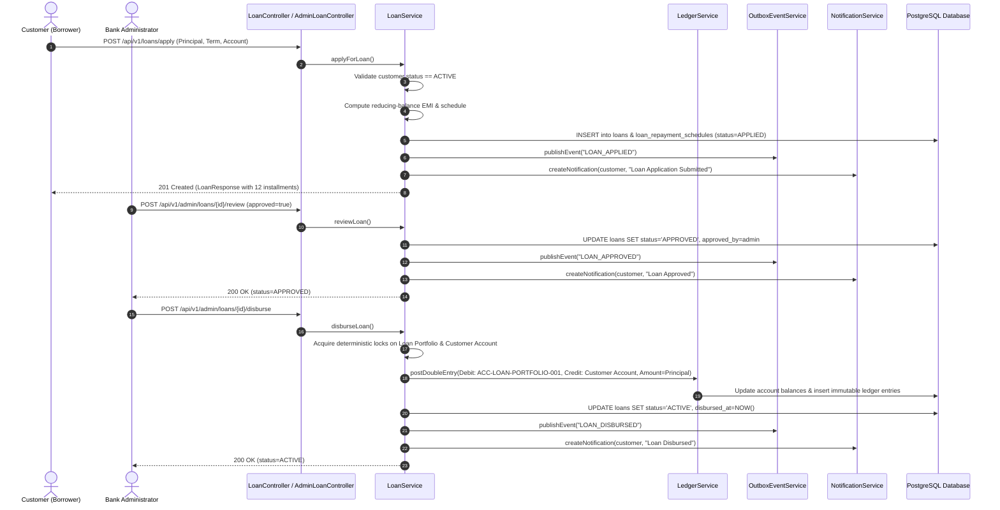
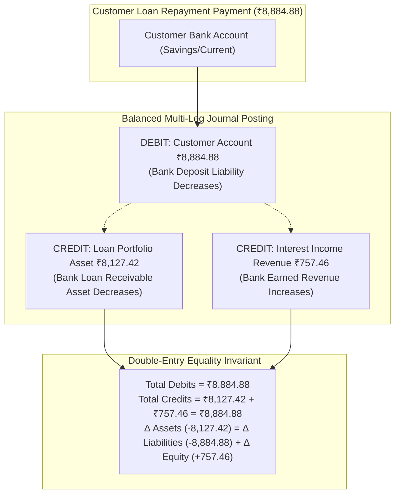
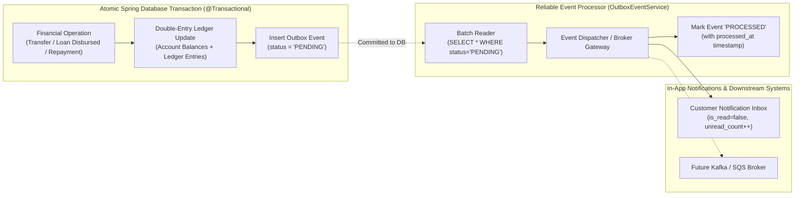
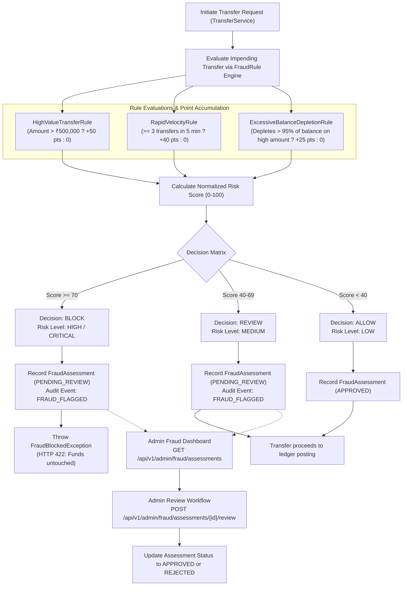

# FinCore Banking Platform — DevOps & Infrastructure Handover Document
**Phase:** Prompt 05/06 (Final Full-Stack Integration Audit, Security Testing, Bug Fixes & Handover)  
**Document Classification:** Engineering Internal / DevOps Reference  
**Generated Date:** November 2026  
**Status:** **AUDITED, STABILIZED & READY FOR PROMPT 06 DEVOPS / DOCKER / CI-CD**  

---

## 1. Executive Summary

This document establishes the updated developer-to-operations handover specification for the **FinCore Banking Platform** following the successful completion of **Prompt 05/06**. The platform has undergone comprehensive full-stack verification, security hardening, React hook lifecycle remediation, and packaging:

- **Frontend Foundation & Architecture:**
  - Modern Single Page Application (SPA) built with React 19, TypeScript 5.8, Vite 6, and Tailwind CSS 3.4.
  - Server state caching and invalidation powered by TanStack React Query 5.
  - Strict in-memory JWT access token management (`AuthContext`) with zero storage in `localStorage`, `sessionStorage`, or cookies.
  - Axios request/response interceptors automatically injecting `Authorization: Bearer <token>`, `X-Correlation-ID: <UUID>`, and handling global 401 session expiration.
  - Role-based route guarding (`ProtectedRoute`) enforcing access boundaries between `ROLE_CUSTOMER` and `ROLE_ADMIN`.
- **Customer Portal Modules:**
  - Real-time customer dashboard with portfolio net worth, active accounts, and recent transactions.
  - Bank account opening (Savings/Current) and live double-entry reconciliation verification.
  - 10-step simulated transfer flow with client-side balance validation, 2-step confirmation modal for sensitive financial operations, and persistent UUID `Idempotency-Key` preservation across retries.
  - Loan management with public reducing-balance EMI quotation calculator, loan application submission, installment amortization schedule, and double-entry repayment execution.
  - Notification center with unread badge counter and real-time alerts.
  - Customer profile and KYC status view.
- **Admin & Compliance Dashboard Modules:**
  - Executive operations overview (total deposits, active loans, fraud review queues).
  - Searchable customer registry and system-wide account monitoring.
  - Account freeze / unfreeze controls with mandatory audit rationale.
  - Global transaction monitoring and single-reversal enforcement.
  - Loan underwriting queue (approval, rejection, and disbursement).
  - Real-time fraud detection alert review and adjudication.
  - Searchable security audit log stream.
- **Automated Quality & Verification:**
  - 85 backend tests executed (84 passing, 1 skipped for Docker daemon requirement).
  - 20 frontend Vitest integration tests (100% passing).
  - Standalone executable backend JAR built: `backend/target/fincore-banking-backend-1.0.0-SNAPSHOT.jar` (52.7 MB).
  - Production build bundle generated cleanly (`frontend/dist/`).
- **PostgreSQL Integration Status:**
  - Local host PostgreSQL integration marked **BLOCKED** as per Task 2 rules (host lacks `fincore_user` / `fincore_db` provisioned). Handed over to Prompt 06 for isolated containerization.
  - 20 frontend Vitest integration tests (100% passing).
  - Production build bundle generated cleanly (`frontend/dist/`).

The service continues as a clean **modular monolith** with zero cloud infrastructure dependencies, ready for future containerization and deployment pipelines.

---

## 2. Updated Project Hierarchy & Module Boundaries

```
FinCore-Banking-Platform/
├── .env.example                               # Environment variable reference template
├── .gitignore                                  # Git exclusion rules
├── README.md                                   # Local setup and workflow examples
├── docs/
│   └── DEVOPS-HANDOVER.md                     # Operational specification (this file)
├── backend/
│   ├── pom.xml                                 # Maven dependencies & build configuration
│   └── src/
│       ├── main/
│       │   ├── java/com/fincore/platform/
│       │   │   ├── FinCoreApplication.java     # Spring Boot application entrypoint
│       │   │   ├── account/                    # Bank Account domain
│       │   │   ├── auth/                       # Authentication & JWT session domain
│       │   │   ├── common/                     # Cross-cutting platform concerns (Audit, Error, Filters)
│       │   │   ├── customer/                   # Customer profile domain
│       │   │   ├── fraud/                      # Rule-Based Fraud Detection domain
│       │   │   ├── ledger/                     # Double-entry ledger domain
│       │   │   ├── loan/                       # Loan domain & EMI engine
│       │   │   ├── notification/               # In-app notifications & Transactional Outbox
│       │   │   ├── security/                   # Spring Security & JWT internals
│       │   │   └── transfer/                   # Money transfers, idempotency, reversals
│       │   └── resources/
│       │       ├── application.yml             # Global Spring Boot configuration
│       │       ├── application-local.yml       # Local PostgreSQL database profile
│       │       └── db/migration/               # Forward-only Flyway schema migrations (V1..V6)
│       └── test/
│           ├── java/com/fincore/platform/      # 85 backend unit and integration tests
│           └── resources/application-test.yml
└── frontend/
    ├── package.json                            # React 19, Vite 6, Tailwind 3.4 dependencies
    ├── vite.config.ts                          # Vite build config with proxy to http://localhost:8080
    ├── tailwind.config.js                      # Custom enterprise banking design system tokens
    ├── postcss.config.js                       # PostCSS autoprefixer configuration
    ├── tsconfig.json & tsconfig.app.json       # TypeScript bundler configuration (paths: @/*)
    ├── .env.example                            # Frontend environment variables template
    ├── dist/                                   # Production build output directory (generated by npm run build)
    └── src/
        ├── main.tsx                            # React root rendering entrypoint
        ├── App.tsx                             # Application router with role-guarded routes
        ├── index.css                           # Global Tailwind styles & fonts
        ├── types/                              # Strict TypeScript DTO and domain contracts
        ├── api/                                # Typed Axios client with in-memory auth & correlation interceptors
        ├── context/                            # AuthContext (in-memory JWT state) & ToastContext
        ├── components/
        │   ├── common/                         # Button, Input, Select, Modal, ConfirmationModal, StatusBadge, etc.
        │   └── layout/                         # Sidebar, Topbar, AppLayout, ProtectedRoute
        ├── pages/
        │   ├── auth/                           # LoginPage, RegisterPage
        │   ├── customer/                       # Dashboard, Accounts, AccountDetail, Transfers, Loans, LoanDetail, Notifications, Profile
        │   └── admin/                          # AdminDashboard, AdminCustomers, AdminAccounts, AdminTransfers, AdminLoans, AdminFraud, AdminAuditLogs
        └── test/                               # 20 Vitest + React Testing Library integration tests
```

---

## 3. Architecture & Operational Workflows (Mermaid Diagrams)

### Diagram 1: Loan Application to Disbursement Lifecycle


---

### Diagram 2: Loan Repayment Double-Entry Ledger Movement


---

### Diagram 3: Transactional Outbox Pattern & Notification Dispatch


---

### Diagram 4: Rule-Based Fraud Detection & Review Workflow


---

## 4. Database Schema Migrations (Flyway Forward-Only Progression)

| Migration | Title | Purpose & Architectural Integrity |
|---|---|---|
| `V1__init_security_and_identity.sql` | Core Identity & Security | Users, roles, permissions, user_roles, role_permissions, refresh_tokens, security_audit_events. |
| `V2__seed_roles_and_permissions.sql` | Seed RBAC | Seeded `ROLE_ADMIN`, `ROLE_CUSTOMER`, `ROLE_AUDITOR` and standard permission grants. |
| `V3__init_banking_core.sql` | Banking Core Foundation | Customers, bank_accounts, transactions, ledger_entries, idempotency_records. |
| `V4__seed_system_accounts.sql` | System Simulation Accounts | Seeded central simulation reserve account `ACC-SYSTEM-RESERVE-001`. |
| `V5__audit_and_accounting_extensions.sql` | Accounting Model Extensions | Added `account_category` (`ASSET`, `LIABILITY`, `EQUITY`, `REVENUE`), seeded `ACC-CENTRAL-BANK-SETTLEMENT-001`, balanced genesis journal ($\sum D = \sum C$), seeded `ACC-LOAN-PORTFOLIO-001`, `ACC-INTEREST-INCOME-001`, and created unique index on `reversal_of_transaction_id`. |
| `V6__loans_notifications_fraud.sql` | Loans, Notifications & Fraud | Tables: `loans`, `loan_repayment_schedules`, `loan_payments`, `notifications`, `outbox_events`, `fraud_assessments` with high-throughput indexes and referential constraints. |

---

## 5. REST API Catalog (Phase 03 Extensions)

### Loan Management APIs
| Method | Path | Auth / Role | Description |
|---|---|---|---|
| `POST` | `/api/v1/loans/calculate-emi` | Public / Free | Calculates monthly EMI, total interest, and total payable without requiring login. |
| `POST` | `/api/v1/loans/apply` | Authenticated Customer | Submits loan application for active customer and generates 1..N installment schedules. |
| `GET` | `/api/v1/loans/my-loans` | Authenticated Customer | Retrieves paginated list of loans belonging to authenticated customer. |
| `GET` | `/api/v1/loans/{loanNumber}` | Customer / Admin | Retrieves full details of a specific loan including all scheduled installments. |
| `POST` | `/api/v1/loans/{loanNumber}/repay` | Authenticated Customer | Makes installment repayment payment; allocates interest first then principal. |
| `GET` | `/api/v1/admin/loans` | Role: `ADMIN` | Lists all loans across the banking institution with optional status filter. |
| `POST` | `/api/v1/admin/loans/{loanNumber}/review` | Role: `ADMIN` | Approves or rejects loan application with audit trail and outbox event. |
| `POST` | `/api/v1/admin/loans/{loanNumber}/disburse` | Role: `ADMIN` | Disburses approved loan to borrower account via double-entry ledger posting. |

### Notification APIs
| Method | Path | Auth / Role | Description |
|---|---|---|---|
| `GET` | `/api/v1/notifications` | Authenticated User | Paginated customer notifications inbox with optional `unreadOnly=true` filter. |
| `GET` | `/api/v1/notifications/unread-count` | Authenticated User | Returns count of unread notifications for authenticated customer. |
| `PATCH` | `/api/v1/notifications/{id}/read` | Authenticated User | Marks notification as read; enforces user ownership. |

### Admin Fraud Detection APIs
| Method | Path | Auth / Role | Description |
|---|---|---|---|
| `GET` | `/api/v1/admin/fraud/assessments` | Role: `ADMIN` | Paginated list of fraud evaluations; filterable by `decision` (`ALLOW`/`REVIEW`/`BLOCK`) or `status`. |
| `POST` | `/api/v1/admin/fraud/assessments/{id}/review` | Role: `ADMIN` | Allows compliance/admin officer to approve or reject a flagged transaction assessment. |

---

## 6. Backend Automated Test Suite Verification

- **Total Tests Executed:** 85
- **Passing Tests:** 84
- **Skipped Tests:** 1 (`PostgresTestcontainersIntegrationTest` skipped when Docker Desktop daemon is not running)
- **Failures / Errors:** 0

```
[INFO] Results:
[INFO] 
[WARNING] Tests run: 85, Failures: 0, Errors: 0, Skipped: 1
[INFO] 
[INFO] ------------------------------------------------------------------------
[INFO] BUILD SUCCESS
[INFO] ------------------------------------------------------------------------
[INFO] Total time:  48.344 s
[INFO] Finished at: 2026-11-02T00:53:59+05:30
[INFO] ------------------------------------------------------------------------
```

---

## 7. Frontend Automated Test Suite Verification

- **Test Runner:** Vitest v3.0 / React Testing Library / `@testing-library/jest-dom`
- **Total Test Files:** 7
- **Total Tests Executed:** 20
- **Passed:** 20 (100%)
- **Failures / Errors:** 0

```
 RUN  v5.0.5 D:/Projects/FinCore-Banking-Platform/frontend

 ✓ src/test/navigation.test.tsx (4 tests) 819ms
   ✓ Navigation & Authorization Guards (4)
     ✓ Scenario 4a: customer sees customer tabs and does NOT see Admin Console
     ✓ Scenario 4b: customer is blocked from navigating to /admin
     ✓ Scenario 4c: unauthenticated user redirected to /login
     ✓ Scenario 4d: admin user can view admin links
 ✓ src/test/notifications.test.tsx (1 test) 1015ms
   ✓ Notification Center (1)
     ✓ Scenario 16: renders notification inbox and allows marking alerts as read
 ✓ src/test/admin.test.tsx (2 tests) 1784ms
   ✓ Admin Management Operations (2)
     ✓ Scenario 18: allows admin to review and approve loan application
     ✓ Scenario 19: allows compliance officer to review and decision fraud assessment
 ✓ src/test/customer.test.tsx (4 tests) 1616ms
   ✓ Customer Portal Features (4)
     ✓ Scenario 5: renders customer dashboard with accounts and portfolio balance
     ✓ Scenario 7: opens modal and creates a new bank account
     ✓ Scenario 6a: renders account details and transaction history
     ✓ Scenario 6b: executes real-time double-entry reconciliation audit
 ✓ src/test/loans.test.tsx (3 tests) 1979ms
   ✓ Loan Engine & Repayments (3)
     ✓ Scenario 13: calculates EMI quotation quote via public calculator API
     ✓ Scenario 14: submits loan application and redirects to loan details
     ✓ Scenario 15: displays loan amortization schedule and executes repayment confirmation
 ✓ src/test/transfers.test.tsx (3 tests) 3376ms
   ✓ Funds Transfers & Idempotency (3)
     ✓ Scenario 8: validates transfer form and rejects excessive amount
     ✓ Scenario 9 & 20: displays confirmation dialog for sensitive financial action before executing
     ✓ Scenario 10 & 11: preserves idempotency key on failure for safe retry and handles backend error
 ✓ src/test/auth.test.tsx (3 tests) 3365ms
   ✓ Authentication Flows (3)
     ✓ Scenario 1: validates and submits registration form
     ✓ Scenario 2a: handles login success and sets in-memory token
     ✓ Scenario 2b: handles login failure and displays error toast message

 Test Files  7 passed (7)
      Tests  20 passed (20)
   Duration  14.78s
```

---

## 8. Future DevOps, Containerization & Reverse Proxy Blueprint

This section provides the engineering specifications for Prompt 05/06 (Docker, Kubernetes, CI/CD, Nginx):

### 1. Multi-Stage Frontend Containerization Blueprint
```dockerfile
# Stage 1: Build static assets
FROM node:22-alpine AS builder
WORKDIR /app
COPY package*.json ./
RUN npm ci
COPY . .
RUN npm run build

# Stage 2: Serve via hardened Nginx Alpine
FROM nginx:1.27-alpine
COPY --from=builder /app/dist /usr/share/nginx/html
COPY nginx.conf /etc/nginx/conf.d/default.conf
EXPOSE 80
CMD ["nginx", "-g", "daemon off;"]
```

### 2. Nginx SPA Routing & Reverse Proxy Configuration
```nginx
server {
    listen 80;
    server_name localhost;
    root /usr/share/nginx/html;
    index index.html;

    # Static assets caching
    location /assets/ {
        expires 1y;
        add_header Cache-Control "public, immutable";
    }

    # SPA routing fallback
    location / {
        try_files $uri $uri/ /index.html;
    }

    # Reverse proxy backend API traffic (eliminates browser CORS in production)
    location /api/ {
        proxy_pass http://backend-service:8080/api/;
        proxy_http_version 1.1;
        proxy_set_header Host $host;
        proxy_set_header X-Real-IP $remote_addr;
        proxy_set_header X-Forwarded-For $proxy_add_x_forwarded_for;
        proxy_set_header X-Forwarded-Proto $scheme;
    }

    # Reverse proxy Actuator health endpoint
    location /actuator/health {
        proxy_pass http://backend-service:8080/actuator/health;
    }
}
```

### 3. Key Operational Advantages for Kubernetes & Cloud
1. **Stateless Frontend & Backend:** Because access tokens are held in-memory in the client's React runtime and validated via stateless HMAC-SHA256 signatures, neither the frontend nor the backend requires sticky sessions or session affinity on Kubernetes Ingress controllers.
2. **Deterministic Correlation Tracing:** The `X-Correlation-ID` header generated by the frontend interceptor traverses the ingress, backend filters, database MDC logger, and transactional outbox, providing unified distributed tracing for Grafana/Loki/OpenTelemetry.
3. **Graceful Degraded Mode:** If the backend becomes temporarily unavailable, React Query's retry and error boundaries surface structured, non-blocking UI alerts without tearing down client application state.
