# FinCore Banking Platform — Implementation Order Guide

This document defines the strict sequential progression for implementing the 32 DevOps engineering manuals. Do not skip manuals or advance to subsequent phases until the preceding phase verification checklist passes.

---

### The Strict Dependency Chain

```mermaid
graph TD
    subgraph Part1["Part 1: Local Docker & Database (Milestone 1)"]
        M01[01: Local Docker Prep] --> M02[02: Postgres Isolation 5435]
        M02 --> M03[03: Backend Dockerfile]
        M03 --> M04[04: Frontend Nginx Dockerfile]
        M04 --> M05[05: Docker Compose Stack]
        M05 --> M06[06: Local Verification & Reconciliation]
    end

    subgraph Part2["Part 2: CI/CD & DevSecOps Pipelines"]
        M06 --> M07[07: Git Branching & Hooks]
        M07 --> M08[08: Jenkins Declarative Pipeline]
        M08 --> M09[09: SonarQube Quality Gates]
        M09 --> M10[10: Dependency Vulnerability Scanning]
        M10 --> M11[11: Trivy Container Scanning & SBOM]
        M11 --> M12[12: DAST with OWASP ZAP]
    end

    subgraph Part3["Part 3: Terraform & AWS Infrastructure"]
        M12 --> M13[13: AWS IAM & S3 State Backend]
        M13 --> M14[14: Terraform Multi-AZ VPC]
        M14 --> M15[15: Terraform EKS Managed Cluster]
        M15 --> M16[16: Terraform Aurora PostgreSQL]
        M16 --> M17[17: Terraform State & Drift Detection]
    end

    subgraph Part4["Part 4: Kubernetes, Helm & GitOps Delivery"]
        M17 --> M18[18: Kubernetes Core Manifests]
        M18 --> M19[19: K8s Security, RBAC & NetworkPolicies]
        M19 --> M20[20: AWS Load Balancer Controller]
        M20 --> M21[21: Helm Packaging & Values Strategy]
        M21 --> M22[22: Argo CD GitOps Continuous Delivery]
    end

    subgraph Part5["Part 5: Observability, Logging, Tracing & SRE"]
        M22 --> M23[23: Prometheus Metrics & Alerting]
        M23 --> M24[24: Grafana Banking Dashboards]
        M24 --> M25[25: Centralized Logging Loki & Promtail]
        M25 --> M26[26: Distributed Tracing OTel & Tempo]
        M26 --> M27[27: SRE SLIs, SLOs & Runbooks]
    end

    subgraph Part6["Part 6: Secrets, MLOps, AIOps & FinOps"]
        M27 --> M28[28: HashiCorp Vault Secrets]
        M28 --> M29[29: MLOps Fraud Detection Pipeline]
        M29 --> M30[30: AIOps Anomaly Detection & RCA]
        M30 --> M31[31: FinOps AWS Cost Optimization]
        M31 --> M32[32: Interview Mastery & Portfolio]
    end
```

---

### Detailed Manual Directory

| Manual # | Document Name | Target Capability |
| :---: | :--- | :--- |
| **01** | [01-local-docker-milestone-preparation.md](file:///D:/Projects/FinCore-Banking-Platform/docs/manual-devops/01-local-docker-milestone-preparation.md) | Windows WSL2, Docker Desktop verification, port conflict prevention |
| **02** | [02-postgresql-container-isolation-flyway.md](file:///D:/Projects/FinCore-Banking-Platform/docs/manual-devops/02-postgresql-container-isolation-flyway.md) | PostgreSQL 16 on host port 5435, isolated named volumes, Flyway V1-V7 |
| **03** | [03-backend-dockerfile-multistage-optimization.md](file:///D:/Projects/FinCore-Banking-Platform/docs/manual-devops/03-backend-dockerfile-multistage-optimization.md) | Multi-stage build, Temurin 21 JRE, layertools extraction, non-root user |
| **04** | [04-frontend-dockerfile-nginx-reverse-proxy.md](file:///D:/Projects/FinCore-Banking-Platform/docs/manual-devops/04-frontend-dockerfile-nginx-reverse-proxy.md) | Node 22 build, Nginx 1.27 Alpine runtime, SPA router fallback, reverse proxy |
| **05** | [05-docker-compose-fullstack-orchestration.md](file:///D:/Projects/FinCore-Banking-Platform/docs/manual-devops/05-docker-compose-fullstack-orchestration.md) | Multi-container composition, health dependencies, bridge network |
| **06** | [06-local-milestone-verification-troubleshooting.md](file:///D:/Projects/FinCore-Banking-Platform/docs/manual-devops/06-local-milestone-verification-troubleshooting.md) | End-to-end API testing, double-entry ledger balance audit, debugging |
| **07** | [07-git-branching-conventional-commits.md](file:///D:/Projects/FinCore-Banking-Platform/docs/manual-devops/07-git-branching-conventional-commits.md) | GitFlow, Conventional Commits, pre-commit hooks, branch protections |
| **08** | [08-jenkins-enterprise-declarative-pipeline.md](file:///D:/Projects/FinCore-Banking-Platform/docs/manual-devops/08-jenkins-enterprise-declarative-pipeline.md) | Declarative Jenkinsfile, agent isolation, multi-stage pipeline |
| **09** | [09-sonarqube-code-quality-security-gates.md](file:///D:/Projects/FinCore-Banking-Platform/docs/manual-devops/09-sonarqube-code-quality-security-gates.md) | SonarQube scanner, coverage analysis, security hotspots, quality gate |
| **10** | [10-dependency-vulnerability-scanning-owasp.md](file:///D:/Projects/FinCore-Banking-Platform/docs/manual-devops/10-dependency-vulnerability-scanning-owasp.md) | OWASP Dependency-Check, Maven/npm vulnerability scanning, CVSS triage |
| **11** | [11-container-security-trivy-sbom.md](file:///D:/Projects/FinCore-Banking-Platform/docs/manual-devops/11-container-security-trivy-sbom.md) | Trivy image scanning, CycloneDX/SPDX SBOM generation, CVE blocking |
| **12** | [12-dast-dynamic-security-testing-zap.md](file:///D:/Projects/FinCore-Banking-Platform/docs/manual-devops/12-dast-dynamic-security-testing-zap.md) | OWASP ZAP baseline scan, API security testing, CSP/CORS validation |
| **13** | [13-aws-account-iam-s3-backend-setup.md](file:///D:/Projects/FinCore-Banking-Platform/docs/manual-devops/13-aws-account-iam-s3-backend-setup.md) | AWS CLI v2, IAM least privilege, S3 encrypted bucket, DynamoDB lock table |
| **14** | [14-terraform-vpc-networking-multi-az.md](file:///D:/Projects/FinCore-Banking-Platform/docs/manual-devops/14-terraform-vpc-networking-multi-az.md) | 3-tier VPC (public, private, db), NAT gateway, route tables, ALB tags |
| **15** | [15-terraform-eks-cluster-managed-node-groups.md](file:///D:/Projects/FinCore-Banking-Platform/docs/manual-devops/15-terraform-eks-cluster-managed-node-groups.md) | EKS 1.30 control plane, IAM OIDC provider, managed node groups |
| **16** | [16-terraform-rds-aurora-postgresql.md](file:///D:/Projects/FinCore-Banking-Platform/docs/manual-devops/16-terraform-rds-aurora-postgresql.md) | Aurora PostgreSQL Serverless v2, subnet groups, secrets manager integration |
| **17** | [17-terraform-state-management-drift-detection.md](file:///D:/Projects/FinCore-Banking-Platform/docs/manual-devops/17-terraform-state-management-drift-detection.md) | State locking, drift detection (`terraform plan -detailed-exitcode`), state migration |
| **18** | [18-kubernetes-core-manifests-architecture.md](file:///D:/Projects/FinCore-Banking-Platform/docs/manual-devops/18-kubernetes-core-manifests-architecture.md) | Deployments, Services, ConfigMaps, Secrets, initContainers, probes |
| **19** | [19-kubernetes-security-rbac-networkpolicies.md](file:///D:/Projects/FinCore-Banking-Platform/docs/manual-devops/19-kubernetes-security-rbac-networkpolicies.md) | Pod security standards, RBAC roles/bindings, zero-trust NetworkPolicies |
| **20** | [20-aws-load-balancer-controller-ingress.md](file:///D:/Projects/FinCore-Banking-Platform/docs/manual-devops/20-aws-load-balancer-controller-ingress.md) | AWS LBC installation, IRSA, Ingress rules, TLS certificate termination |
| **21** | [21-helm-packaging-values-environments.md](file:///D:/Projects/FinCore-Banking-Platform/docs/manual-devops/21-helm-packaging-values-environments.md) | Helm chart structure, `values-dev.yaml` vs `values-prod.yaml`, templating |
| **22** | [22-argocd-gitops-continuous-delivery.md](file:///D:/Projects/FinCore-Banking-Platform/docs/manual-devops/22-argocd-gitops-continuous-delivery.md) | Argo CD installation, Application CRDs, automated sync, self-healing |
| **23** | [23-prometheus-metrics-collection-alerting.md](file:///D:/Projects/FinCore-Banking-Platform/docs/manual-devops/23-prometheus-metrics-collection-alerting.md) | Micrometer actuator scraping, Prometheus alerting rules, PromQL queries |
| **24** | [24-grafana-dashboards-banking-visualization.md](file:///D:/Projects/FinCore-Banking-Platform/docs/manual-devops/24-grafana-dashboards-banking-visualization.md) | Grafana dashboard provisioning, Golden Signals, banking KPI visualizer |
| **25** | [25-centralized-logging-loki-promtail.md](file:///D:/Projects/FinCore-Banking-Platform/docs/manual-devops/25-centralized-logging-loki-promtail.md) | Promtail log ingestion, Loki log aggregation, LogQL forensic queries |
| **26** | [26-distributed-tracing-opentelemetry-tempo.md](file:///D:/Projects/FinCore-Banking-Platform/docs/manual-devops/26-distributed-tracing-opentelemetry-tempo.md) | OpenTelemetry collector, Tempo trace backend, trace context propagation |
| **27** | [27-sre-sli-slo-error-budgets-runbooks.md](file:///D:/Projects/FinCore-Banking-Platform/docs/manual-devops/27-sre-sli-slo-error-budgets-runbooks.md) | SLI/SLO definitions, error budget burn rates, Sev-1 incident runbooks |
| **28** | [28-devsecops-vault-secrets-management.md](file:///D:/Projects/FinCore-Banking-Platform/docs/manual-devops/28-devsecops-vault-secrets-management.md) | HashiCorp Vault Agent Injector, dynamic database credentials, rotation |
| **29** | [29-mlops-fraud-detection-model-lifecycle.md](file:///D:/Projects/FinCore-Banking-Platform/docs/manual-devops/29-mlops-fraud-detection-model-lifecycle.md) | MLflow model tracking, synthetic dataset training, feature store specs |
| **30** | [30-aiops-anomaly-detection-automated-rca.md](file:///D:/Projects/FinCore-Banking-Platform/docs/manual-devops/30-aiops-anomaly-detection-automated-rca.md) | Isolation forest anomaly detection, log clustering, automated RCA rules |
| **31** | [31-finops-aws-cost-optimization-tagging.md](file:///D:/Projects/FinCore-Banking-Platform/docs/manual-devops/31-finops-aws-cost-optimization-tagging.md) | Cost allocation tags, NAT Gateway cost reduction, Spot/Graviton instances |
| **32** | [32-portfolio-presentation-interview-mastery.md](file:///D:/Projects/FinCore-Banking-Platform/docs/manual-devops/32-portfolio-presentation-interview-mastery.md) | Resume bullets, GitHub architecture presentation, Staff interview scripts |

