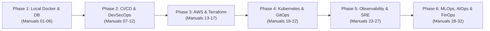

# FinCore Banking Platform — DevOps Engineering Handbook
## START HERE: Welcome & Operating Principles

Welcome to the **FinCore Banking Platform Manual DevOps, DevSecOps, AWS, SRE, MLOps & AIOps Engineering Handbook**.

This handbook is designed specifically for an engineer with ~6.6 years of total IT experience and ~4 years of DevOps experience who wants to build an **enterprise-grade, interview-ready portfolio** by manually executing every stage of modern cloud and platform engineering.

---

### 1. Architectural Overview & Context

FinCore is an enterprise-style digital banking simulation featuring:
- **Backend:** Java 21 / Spring Boot 3.4.1 modular monolith with JWT authentication, RBAC, JPA/Hibernate, Flyway database migrations, and financial ledger rules.
- **Frontend:** React 18 / TypeScript / Vite / TailwindCSS single-page application with customer self-service and banker/admin back-office portals.
- **Ledger Invariant:** Strict double-entry accounting where every debit is balanced by an equal credit, enforcing zero unbacked money creation.
- **Database:** PostgreSQL with relational integrity, pessimistic row locking (`SELECT FOR UPDATE`), and Flyway schema evolution (V1 through V7).

---

### 2. The Core Philosophy: Manual Execution & Mastery

> [!IMPORTANT]
> **No automated magic or blind script execution.**
> All infrastructure configurations located under `devops-configurations/` are intentionally marked **UNTESTED** until YOU execute, verify, and document them on your machine and AWS account.
> This hands-on process guarantees that you experience genuine operational friction: troubleshooting port collisions, debugging container healthchecks, fixing IAM permission boundaries, and tuning JVM heap memory.

---

### 3. The 6 Implementation Phases

#### Phase 1: Local Docker Milestone (MANDATORY GATEWAY)
- **Goal:** Run PostgreSQL in a Docker container on isolated host port `5435`, run backend on `8080`, and frontend on `80`/`5173`.
- **Rule:** Do NOT provision cloud resources until Milestone 1 passes 100% locally.

#### Phase 2: Git, CI/CD & DevSecOps Pipelines
- **Goal:** Implement Jenkins declarative pipelines, Gitleaks secret detection, SonarQube quality gates, OWASP dependency checking, Trivy container scanning, and ZAP dynamic testing.

#### Phase 3: Terraform & AWS Cloud Infrastructure
- **Goal:** Provision multi-AZ VPC, EKS 1.30 managed cluster, Aurora PostgreSQL Serverless v2, IAM roles with least privilege, and S3 remote state locking.

#### Phase 4: Kubernetes, Helm & GitOps Delivery
- **Goal:** Deploy zero-trust microservice architecture using Argo CD GitOps, AWS Load Balancer Controller (ALB), Pod Disruption Budgets, HPA, and NetworkPolicies.

#### Phase 5: Observability, Logging, Tracing & SRE
- **Goal:** End-to-end monitoring using Prometheus, Grafana, Promtail + Loki, OpenTelemetry + Tempo, establishing SLIs, SLOs, and incident response runbooks.

#### Phase 6: DevSecOps Secrets, MLOps, AIOps & FinOps
- **Goal:** HashiCorp Vault integration, MLflow model governance for fraud detection, Prometheus anomaly detection engine, and AWS cost optimization.

---

### 4. Critical Host Environment Guardrails

| Resource | Status on Host | Action Required |
| :--- | :--- | :--- |
| **Host Port 5432** | OCCUPIED by local Windows PostgreSQL 18 | **NEVER touch or stop this service.** |
| **Host Port 5434** | OCCUPIED by external project | Leave completely untouched. |
| **Host Port 5435** | **FREE / DEDICATED** | Map container `fincore-db` port `5435:5432`. |
| **Host Port 8080** | Target for Spring Boot Backend | Ensure no conflicting local Tomcat/Jenkins. |
| **Host Port 80 / 5173** | Target for Frontend Portal & Nginx | Standard browser endpoints. |

---

### 5. Document Navigation Index

- **[Implementation Order Guide](file:///D:/Projects/FinCore-Banking-Platform/docs/manual-devops/IMPLEMENTATION-ORDER.md)**: Sequential walkthrough of all 32 manuals.
- **[Prerequisites & Tooling](file:///D:/Projects/FinCore-Banking-Platform/docs/manual-devops/PREREQUISITES.md)**: Required CLI tools, versions, and accounts.
- **[Progress Checklist](file:///D:/Projects/FinCore-Banking-Platform/docs/manual-devops/PROGRESS-CHECKLIST.md)**: Interactive checklist tracking your progress.
- **[Interview Readiness Guide](file:///D:/Projects/FinCore-Banking-Platform/docs/manual-devops/INTERVIEW-GUIDE.md)**: How to frame this platform in Senior/Staff DevOps interviews.
- **Configuration Templates Directory**: `devops-configurations/`

> [!TIP]
> Begin immediately with **[Manual 01: Local Docker Milestone Preparation](file:///D:/Projects/FinCore-Banking-Platform/docs/manual-devops/01-local-docker-milestone-preparation.md)**.

